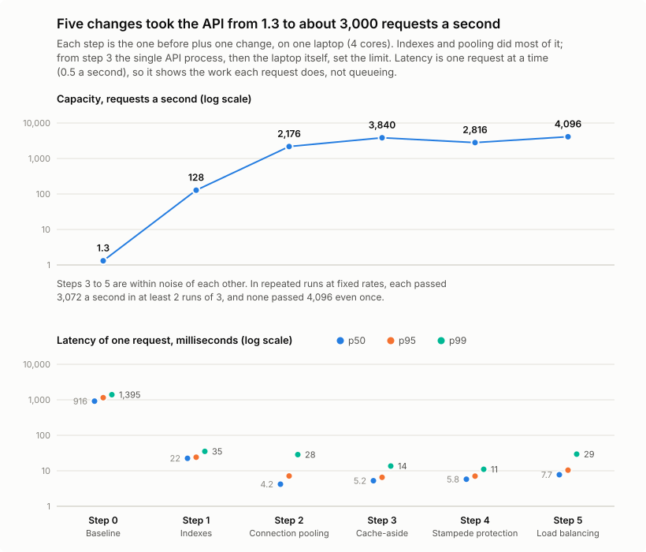
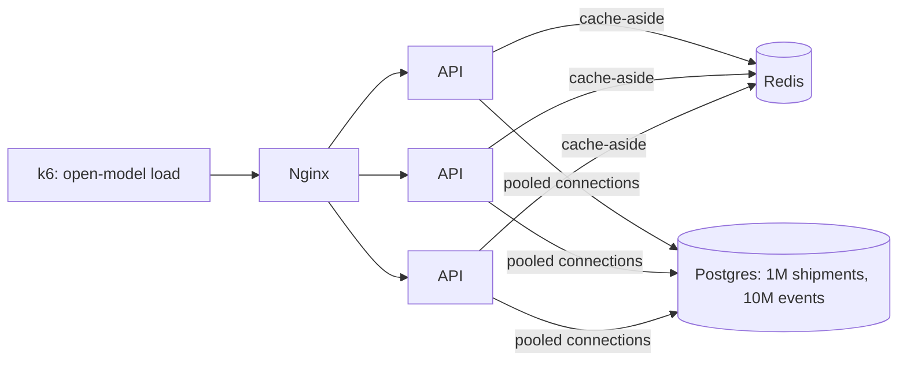

# Scaling ladder

A shipment-tracking API taken from slow to fast one change at a time, with every step measured by
the same load test: indexes, connection pooling, a Redis cache with invalidation, stampede
protection, then a load balancer in front of three instances. For each step: what it bought, what
it cost, and where the bottleneck moved.

[](https://github.com/Hameesmahmood/scaling-ladder/actions/workflows/ci.yml)

<picture>
  <source media="(prefers-color-scheme: dark)" srcset="docs/ladder-dark.svg">
  
</picture>

**From 1.3 to about 3,000 requests a second, and most of it came from two changes: indexes (98
times) and connection pooling (17 times again).** The cache added about half again, by taking the
load off Postgres. After that, on one laptop, the API process and then the laptop itself were the
limit. [All the results, and how to rerun them](docs/RESULTS.md).

## The problem

"How would you scale this?" has a standard answer: add indexes, pool connections, add a cache, put a
load balancer in front. The list is easy to recite. What's harder, and what real incidents test, is
knowing what each change buys, what it costs, and where the bottleneck goes next.

So this is an experiment. A small API ("where's my parcel?") starts deliberately naive and gets one
change at a time. After every change the same load test runs, and each step records its capacity,
its latency, the database's work per request and every container's CPU.



## The ladder

Each step is the previous one plus one change, switched on by configuration, so any step can be
rerun on its own.

| Step | Change | Capacity | What ran out | The cost |
| --- | --- | --- | --- | --- |
| 0 | Baseline: primary keys only, a connection per request | 1.3/s | Postgres, scanning 10 million rows per lookup | |
| 1 | Indexes matching each query | 128/s | Postgres, starting a server process per request | Writes 9% slower and 2.6× the WAL; 373 MB on disk |
| 2 | Connection pooling (20 per instance) | 2,176/s | Postgres, running the queries; the API at its limit too | Requests queue when the pool is full |
| 3 | Redis cache-aside, 60 s TTL, deleted on write | about 3,000/s | The API process | A race can serve a stale read for up to the TTL; one more thing to run |
| 4 | Stampede protection: coalescing, jittered TTLs | about 3,000/s | The API process | Callers waiting on a shared read share its fate |
| 5 | Nginx in front of three instances | about 3,000/s | The laptop's 4 cores | More processes, and a pool each on the database |

Capacity is the highest arrival rate a step sustains with p99 under 250 ms, under 0.1% failures and
no requests started late. Near its limit one capacity search lands about 25% either way, so for
steps 3 to 5 the figure is from repeated runs at fixed rates: each passed 3,072 a second in at least
2 runs of 3, and none passed 4,096 once. [RESULTS.md](docs/RESULTS.md) has every number with its
source file and commit.

## Each concept switched off

| Concept | With it | Without it |
| --- | --- | --- |
| Indexes | The events query is a 0.14 ms index scan | An 842 ms parallel scan of 10 million rows |
| Connection pooling | 50 concurrent requests open at most the pool's 5 connections | They open 50 |
| Cache-aside and TTL | The second read comes from Redis; after the TTL, from Postgres | Every read goes to Postgres |
| Invalidation | 0 stale in 536 reads straight after a write, under load | 469 stale in 469 |
| Failing fast when Redis is down | Reads and writes carry on through Postgres without waiting | Each request waited out a 5-second timeout (the client's default, seen before the fix) |
| Stampede protection | 200 concurrent misses on one key run 1 query | They run 200 |
| TTL jitter | 100 entries cached together expire over 48 to 72 s | Within 2 s of each other |
| Load balancing with retries | Killing one of three instances mid-run fails 0 of 54,217 lookups | 24 of 53,945 fail |

The invalidation, kill and index rows are load experiments (`scripts/`); the rest are integration
tests against real Postgres and Redis (`dotnet test`).

## Try it

You need Docker. Start the stack, seed a small database (the ladder's million shipments take about
9 minutes to seed), and look a parcel up:

```bash
docker compose up -d --build --wait
SHIPMENTS=20000 CUSTOMERS=2000 ./scripts/db.sh seed
curl -i localhost:8090/v1/shipments/SL0000000100
```

The stack starts at step 0's settings. Turn on pooling and the cache, and ask twice:

```bash
TRACKER_POOLING=true TRACKER_CACHE=true docker compose up -d --wait api
curl -si localhost:8090/v1/shipments/SL0000000100 | grep X-Cache    # X-Cache: miss
curl -si localhost:8090/v1/shipments/SL0000000100 | grep X-Cache    # X-Cache: hit
```

```
HTTP/1.1 200 OK
X-Cache: hit

{"tracking_number":"SL0000000100","service":"standard","origin":"Quetta","destination":"Toronto",
 "status":"in_transit", ..., "events":[...]}
```

Stop everything with `docker compose down --volumes`.

### Run the ladder

```bash
./scripts/db.sh seed                 # the full dataset, once
python3 scripts/ladder.py all        # every step, about 2 hours; one step: python3 scripts/ladder.py 3
python3 tools/chart.py               # redraw the chart from results/
dotnet test                          # the tests; needs the .NET 10 SDK and Docker
```

Each step sets the database's indexes, restarts the API with its settings and an empty Redis, warms
up, measures latency at 0.5 requests a second, then searches for its capacity. The results go to
`results/step-N.json`. CI runs the tests, and the whole ladder at toy rates on a small seed to check
every step still works.

## API

| Method and path | Purpose | Responses |
| --- | --- | --- |
| `GET /v1/shipments/{trackingNumber}` | A shipment and its 20 most recent tracking events. The hot path, and the one that's cached | `200`, `404` |
| `GET /v1/customers/{customerId}/shipments?limit=20&cursor=` | A customer's shipments, newest first, keyset pagination | `200`, `400` |
| `POST /v1/shipments/{trackingNumber}/events` | Record a tracking event and update the shipment's status | `201`, `400`, `404` |
| `GET /healthz`, `GET /readyz` | Liveness, and readiness including Postgres and Redis | `200`, `503` |
| `GET /stats` | The instance's cache counters, for the ladder and the tests | `200` |

Errors use [RFC 9457](https://www.rfc-editor.org/rfc/rfc9457) problem details.

## Design decisions

- **An open-model load test.** k6 starts requests on a fixed schedule whether or not earlier ones
  have finished, so a slow server shows up as latency and late starts instead of quietly slowing the
  test down (coordinated omission).
- **A skewed workload, stated.** 90% of requests look up a shipment, 80% of those from the 1% in
  transit; 8% list a customer's shipments; 2% record an event. Caches look great on skewed traffic
  and useless on uniform traffic.
- **Resources pinned.** Each API instance gets 1 CPU, Postgres 2 CPUs and 2 GB, Redis and Nginx 1
  each, so the steps compare fairly.
- **Redis is an optimisation, never a dependency.** Any Redis error or timeout falls through to
  Postgres, and the client fails fast instead of queueing commands while it reconnects.
- **Delete after commit.** Deleting the cache entry before the write commits lets a read in between
  refill the old row. The remaining race is accepted, bounded by the TTL, and counted under load.
- **Coalescing is per instance.** With three instances a key can be rebuilt three times at once; a
  Redis lock would make that one, at the cost of a round trip on every miss.
- **A write also drops a rebuild in progress**, or a read that starts after the write could join a
  rebuild that started before it and return the old status.
- **Nginx retries reads, never writes.** A `GET` that fails on one instance goes to another. A `POST`
  already sent isn't resent, because recording an event twice is worse than failing it.

## Limits

- **One laptop**, a 4-core i7 with 8 hyperthreads, running Docker Desktop and the load generator
  too. The steps compare with each other; none of the figures say what this would do on real
  servers. Step 5 in particular is capped by the machine: on separate machines the three instances
  wouldn't share cores with each other, Postgres and k6.
- **The baseline is deliberately bad.** Real systems rarely start with no indexes, so the 98-fold
  jump is the size of a missing-index incident, not of a typical tuning win.
- **One capacity search isn't precise** near a step's limit: about 25% either way. That's why steps
  3 to 5 rest on repeated runs.
- **Not a product.** No auth, no UI, three endpoints: enough for a hot read, a list query and writes
  that make caching hard.

## Layout

```
src/Tracker.Api/     endpoints, the store (Npgsql and Dapper, hand-written SQL), the cache and its coalescing
tests/Tracker.Tests/ xUnit with Testcontainers: pooling, cache, invalidation, Redis down, stampede, jitter
db/                  schema, seed, the step-1 indexes
load/workload.js     the k6 workload
nginx/               the load balancer's config, with and without retries
scripts/             the ladder, repeats, stale reads, instance kill, index write cost, database helpers
tools/chart.py       the chart
results/             every run's raw output
docs/                results, the implementation plan, the chart
```

Built with .NET 10 minimal APIs, Npgsql, Dapper, StackExchange.Redis, Postgres 18, Redis 8,
Nginx 1.28, k6 and Docker Compose.

## License

MIT
