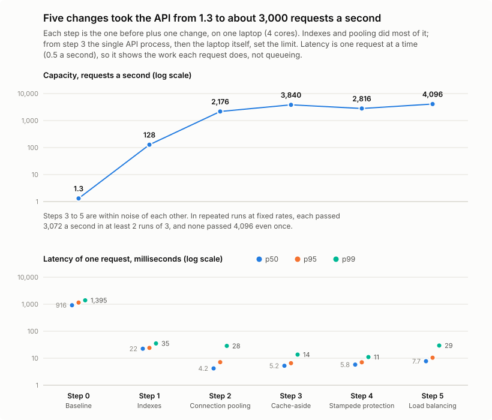

# Results: the scaling ladder

The question: when you take a slow API and apply the standard fixes one at a time, what does each
one buy, what does it cost, and where does the bottleneck go next?

<picture>
  <source media="(prefers-color-scheme: dark)" srcset="ladder-dark.svg">
  
</picture>

## The headline run

Every step was measured in one run of `python3 scripts/ladder.py all` at commit `6436518`, on
27 November 2026, with no uncommitted changes. Each step's raw output, including every probe of the
capacity search, is in `results/step-N.json`.

| Step | Change | Capacity, one search | Repeated runs at fixed rates | Median latency, one request | Rows read per request, at capacity | What ran out |
| --- | --- | --- | --- | --- | --- | --- |
| 0 | Baseline | 1.31/s | | 916 ms | 10.1 million | Postgres (1.65 of its 2 cores) |
| 1 | Indexes | 128/s | | 22 ms | 636 | Postgres (1.79 of 2) |
| 2 | Connection pooling | 2,176/s | 2,048 passed 2 of 3, 2,560 failed 3 of 3 | 4.2 ms | 34 | Postgres (1.93 of 2), and the API at its 1-CPU limit |
| 3 | Redis cache-aside | 3,840/s | 3,072 passed 2 of 3, 4,096 failed 3 of 3 | 5.2 ms | 8.3 | The API process (at its 1-CPU limit) |
| 4 | Stampede protection | 2,816/s | 3,072 passed 2 of 3, 4,096 failed 3 of 3 | 5.8 ms | 9.0 | The API process (at its 1-CPU limit) |
| 5 | Nginx, three instances | 4,096/s | 3,072 passed 3 of 3, 3,584 failed 3 of 3 | 7.7 ms | 8.0 | The laptop (6.6 of 8 hyperthreads busy) |

**Capacity** is the highest arrival rate a step sustains for a whole probe with p99 under 250 ms
(or twice its single-request p99, if that's higher: only the baseline needs it), under 0.1% failed
requests, and no requests k6 failed to start on time. The search doubles the rate until a probe
fails, then bisects to within 10%. A failed probe is run twice more and the rate passes if 2 of 3
runs do.

**Median latency** is from 90 requests sent one at a time (0.5 a second for 3 minutes), so it shows
the work in one request, not queueing. The p99 of 90 requests is about the slowest one or two of
them, so it moves around between runs (step 5's was 53 ms in one run and 29 ms in the next). The
chart shows it, but read the median.

**What ran out** comes from each container's CPU, sampled halfway through the probe at the step's
capacity. Docker reports a 1-CPU container at its limit as 1.17 to 1.19 cores.

## What each step bought, and where the bottleneck went

**Step 0, the baseline: 1.3 requests a second.** Primary keys only, so looking up a shipment scans
all million shipments and then all ten million tracking events to find its last 20: about 900 ms
in Postgres, which keeps it busy at barely more than one lookup a second. It's deliberately naive: it's the starting point a missing-index incident
looks like.

**Step 1, indexes: 98 times the capacity, 1.3 to 128.** Three indexes, matching each query's
`WHERE` and `ORDER BY`. The plans in `results/plans-without-indexes.txt` and
`results/plans-with-indexes.txt` show it: the events query goes from an 842 ms parallel
sequential scan to a 0.14 ms index scan, the lookup from 67 ms to 0.16 ms, the customer's list from
103 ms to 0.27 ms. Rows read per request fall from 10 million to 636. Postgres is still the
bottleneck, but now most of its work is setup: every request still opens a new connection, which
costs Postgres a new server process. The queries themselves read under 50 rows (by their plans).

**Step 2, connection pooling: 17 times again, 128 to 2,176.** Npgsql's pool (20 connections)
means requests reuse connections instead of opening one each: connections opened per request fall
from 1.08 to 0.01, and rows per request from 636 to 34, about what the queries read. So the other
600 came with opening a connection. Postgres is at 1.93 of its 2 cores again, but now it's doing the
queries, and the API process is at its limit too. The same step has reproduced 2,176 in three
separate runs.

**Step 3, the Redis cache: about 1.5 times, to about 3,000.** Cache-aside on the hot read, with a
60-second TTL and the entry deleted after every write commits. At capacity 73% of lookups are hits,
rows per request fall from 34 to 8, and Postgres drops to about 1.2 cores. The bottleneck has left
the database: what's at its limit is the single API instance. A hit costs it less than a Postgres
read did (one Redis value instead of a query and up to 20 event rows to map), which is where the
extra capacity comes from.

The cache doesn't make one request faster: the median goes from 4.2 to 5.2 ms. At 0.5 requests a
second almost nothing is read twice within its TTL, so almost every read is a miss (the light runs
show a hit rate of 0), and a miss is a Redis round trip and then the same Postgres read. Caching buys
capacity under load, not latency for a cold read.

**Step 4, stampede protection: no change, as expected.** Concurrent misses on one key share a single
Postgres read, and each entry's TTL is spread by up to 20% so entries cached together don't expire
together. Under the ladder's workload it barely engages: about 0.03 requests per request joined
another's read, and only at 4,096 a second. With the indexes a rebuild takes about a millisecond, too
short for misses to pile up. Its value is for slow rebuilds and very hot keys, and the stampede test
shows it: with the rebuild held up, 200 concurrent misses on one key run 1 query instead of 200. On
throughput, steps 3 and 4 are indistinguishable (next section).

**Step 5, Nginx in front of three instances: limited by the laptop.** Three instances, so the API
is no longer the limit: each runs at about 0.9 of its core. But the laptop has 4 physical cores (8
hyperthreads), and at 4,096 a second the containers and k6 together use 6.6 of the 8, up to 7.6 at
higher rates. The symptom is k6, the load generator, failing to start requests on time while p99
stays low: 25 to 150 ms at 4,096 and 4,608 a second, where steps 3 and 4 reached 0.27 to 6.6 s. That's the machine
running out, not the design. On separate machines the instances wouldn't share cores with each
other, Postgres and the load generator. What step 5 does show here is in the next sections: with
retries, killing an instance fails no reads.

## How much one capacity search can be trusted

Not to within 25%, near a step's limit, on this laptop. The single search above ranks step 3
(3,840) above step 4 (2,816), but step 4 only adds coalescing and jitter, which barely engage. The
logs show the luck: step 3 passed 3,072, 3,584 and 3,840 at the first attempt each; step 4 failed
its first 3,072 probe (p99 539 ms, 4,429 requests not started on time), passed the second and failed
the third.

So steps 2 to 5 were repeated at fixed rates, three 30-second runs at each, after a warm-up
(`scripts/repeat.py`). The pass rule is the ladder's.

| Rate | Step 2 | Step 3 | Step 4 | Step 5 |
| --- | --- | --- | --- | --- |
| 1,536/s | 3 of 3 | | | |
| 2,048/s | 2 of 3 | | | |
| 2,560/s | 0 of 3 | 2 of 3 | 2 of 3 | 2 of 3 |
| 3,072/s | | 2 of 3 | 2 of 3 | 3 of 3 |
| 3,584/s | | 1 of 3 | 1 of 3 | 0 of 3 |
| 4,096/s | | 0 of 3 | 0 of 3 | 0 of 3 |
| 4,608/s | | 0 of 3 | 0 of 3 | 0 of 3 |

Step 2 is from `results/repeat-steps-2-3.json` (26 November); steps 3 to 5 are from
`results/repeat-steps-3-4-5.json` (commit `0667b9f`, the same code as the headline run). An earlier
repeat of step 3 passed 2,560 a second 3 times in 3; this one passed it 2 times in 3.

The honest reading: the cache moved capacity from about 2,000 to about 3,000 a second; stampede
protection and the extra instances didn't move it on this machine; and the steps' order is only
meaningful where the gaps are bigger than about 25%.

## Experiments for each concept switched off

The ladder is the performance evidence. These show what breaks without each piece.

**Invalidation: stale reads under load** (`scripts/stale_reads.py`, 200 requests a second for
2 minutes, every write followed by a read of the same shipment that checks for the event just
written):

| | Step 3 | Step 4 (coalescing on) |
| --- | --- | --- |
| Invalidation on | 0 stale of 536 | 0 stale of 496 |
| Invalidation off | 469 stale of 469 | 476 stale of 476 |

`results/stale-reads.json` (commit `01149be`) and `results/stale-reads-step-4.json` (commit
`4998c2e`). Step 4 is measured separately because coalescing adds a way to read stale: a read that
starts after a write could join a rebuild that started before it. A write now also drops any rebuild
in progress, and the step 4 run shows that holds.

**Load balancing: killing one of three instances** (`scripts/kill_instance.py`, 1,000 requests a
second for 60 s, the second instance killed with `SIGKILL` at 20 s):

| | Lookups failed | Customer lists failed | Writes failed |
| --- | --- | --- | --- |
| Nginx retries on | 0 of 54,217 | 0 of 4,647 | 2 of 1,138 |
| Nginx retries off | 24 of 53,945 | 3 of 4,806 | 2 of 1,249 |

`results/kill-instance.json` (commit `4998c2e`). The 2 failed writes are the ones in flight when the
instance died. Nginx deliberately doesn't resend a `POST` it has already sent, because recording an
event twice is worse than failing it; the client gets an error and can retry with knowledge of what
it sent.

**Indexes: what they cost writes** (`scripts/write_cost.py`, `pgbench` with 4 clients, 3 alternating
rounds of 30 s, each write inserting an event and updating its shipment):

| | Writes a second | p50 | p99 | WAL written per write |
| --- | --- | --- | --- | --- |
| Without indexes | 1,368 | 2.17 ms | 25 ms | 3.5 KB |
| With indexes | 1,241 | 2.25 ms | 26 ms | 9.0 KB |

`results/index-write-cost.json` (commit `01149be`), medians of the 3 rounds. Writes are 9% slower
and write 2.6 times the WAL, since every insert now updates an index too. The three indexes take
373 MB on disk (304 MB of it the events index) and 12.4 s to build. Measured with `pgbench` rather
than through the API, because without indexes the API's write starts with a 70 ms lookup that would
hide what the indexes cost.

**The rest are tests** (`dotnet test`, against real Postgres and Redis in Testcontainers): 50 concurrent
requests open at most 5 connections with a pool of 5, and 50 without one; the second
read comes from Redis and after the TTL from Postgres again; with Redis unreachable, reads and writes
carry on through Postgres without waiting on it; with the rebuild held up, 200 misses on one key run 1
query with coalescing and 200 without; 100 entries cached together expire spread over 48 to 72 s
with jitter, and within 2 s of each other without.

## Things the method had to learn

- **A freshly started API fails its first heavy probe**, whatever the step. Step 3's first search
  measured 960 a second, below step 2, because it started at 1,024 on a cold process. Every search
  now runs 30 s at its starting rate first, discarded.
- **One probe near the limit can't decide a step's capacity**, so a failure is run twice more and the
  rate passes on 2 of 3. Even that isn't enough for steps 3 to 5, hence the repeats above.
- **Redis is emptied and its statistics reset at the start of every step**, so no step inherits a
  warm cache.
- **From step 4, Redis's own miss count is doubled**, because a miss looks in Redis once more before
  reading Postgres. Hit rates come from the API's own counters (`/stats`).

## Limits

- **One laptop.** An Intel Core i7-4770HQ (4 cores, 8 threads) running Docker Desktop, with every
  container pinned: each API instance 1 CPU, Postgres 2 CPUs and 2 GB, Redis and Nginx 1 each. The
  steps compare with each other. None of the figures say what this API would do on real servers,
  and step 5 in particular is capped by the machine.
- **The load generator shares the machine.** k6 needs 1 to 3 cores at the top rates, taken from the
  same 8 threads.
- **The workload is skewed on purpose.** 80% of lookups go to the 1% of shipments in transit, which
  is what makes the cache work. On uniform traffic the hit rate, and step 3's gain, would be much
  lower.
- **The baseline is deliberately bad.** Real systems rarely start with no indexes at all, so the
  98-fold jump is the size of a missing-index incident, not of a typical tuning win.
- **The side experiments ran at earlier commits** (named above for each). The code they exercise
  hasn't changed since.

## Rerun it

You need Docker. Seeding takes about 9 minutes once; the full ladder takes about 2 hours.

```bash
./scripts/db.sh seed                       # 1,000,000 shipments, about 10,000,000 events
python3 scripts/ladder.py all              # every step; or one: python3 scripts/ladder.py 3
python3 scripts/repeat.py --steps 3 4 5 --rates 2560 3072 3584 4096 4608 --repeats 3
python3 scripts/stale_reads.py --step 4
python3 scripts/kill_instance.py
python3 scripts/write_cost.py
python3 tools/chart.py                     # redraws docs/ladder-*.svg from results/
```

CI runs the tests and a smoke run of the whole ladder (`ladder.py all --quick` on a 20,000-shipment
seed), which checks that every step still works end to end. Its numbers mean nothing.
